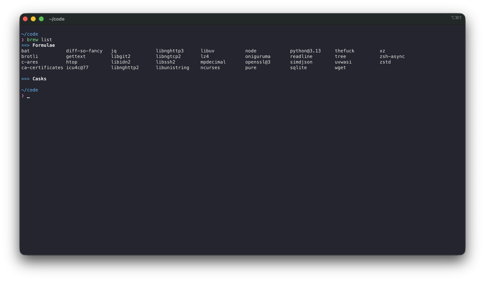

# dotfiles

Dotfiles to setup macOS the way I like it.

## Homebrew

Install [Homebrew](https://brew.sh/):

```sh
$ /bin/bash -c "$(curl -fsSL https://raw.githubusercontent.com/Homebrew/install/HEAD/install.sh)"
```

Run [homebrew.sh](homebrew.sh) to install the formulas.

## Oh My Zsh

Install [Oh My Zsh](https://ohmyz.sh/):

```sh
$ sh -c "$(curl -fsSL https://raw.githubusercontent.com/ohmyzsh/ohmyzsh/master/tools/install.sh)"
```

Install [zsh-autosuggestions](https://github.com/zsh-users/zsh-autosuggestions) plugin:

```sh
$ git clone https://github.com/zsh-users/zsh-autosuggestions ${ZSH_CUSTOM:-~/.oh-my-zsh/custom}/plugins/zsh-autosuggestions
```

Install [zsh-syntax-highlighting](https://github.com/zsh-users/zsh-syntax-highlighting) plugin:

```sh
$ git clone https://github.com/zsh-users/zsh-syntax-highlighting.git ${ZSH_CUSTOM:-~/.oh-my-zsh/custom}/plugins/zsh-syntax-highlighting
```

Install [nvm](https://github.com/nvm-sh/nvm):

```sh
$ curl -o- https://raw.githubusercontent.com/nvm-sh/nvm/v0.40.3/install.sh | bash
```

Replace the [.zshrc](.zshrc) file and source it. It will set some defaults, activate the `zsh plugins`, `nvm` and init the [Pure prompt](https://github.com/sindresorhus/pure).

## Git

Replace the [.gitconfig](.gitconfig) file. It will set some defaults and enable [diff-so-fancy](https://github.com/so-fancy/diff-so-fancy).

## iTerm

Download and install [iTerm](https://iterm2.com/).

Set the [Snazzy theme](https://github.com/sindresorhus/iterm2-snazzy) by opening the [Snazzy.itermcolors](iterm/Snazzy.itermcolors) in Finder.

Go to `Settings > Profiles > Text`, change the Cursor to `_`, the Font to `Menlo` and set the size to `13`.

The final result should be very similar to this:


## License

[MIT](LICENSE)
